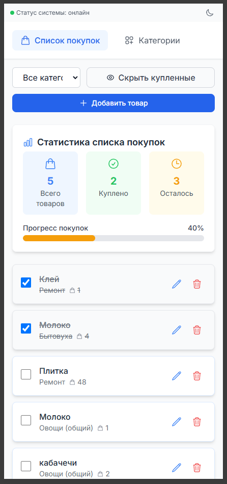

# Nakupi Bot Service



Сервис Telegram-бота для управления списками покупок. Позволяет создавать категории покупок, добавлять в них товары и отмечать их как купленные/не купленные.

## Возможности

- Создание и управление категориями покупок
- Добавление товаров в список покупок
- Отметка товаров как купленные/не купленные
- Просмотр списка покупок по категориям

## Технологии

- **TypeScript** - основной язык разработки
- **Node.js** - среда выполнения
- **Telegraf** - фреймворк для создания Telegram-ботов
- **MongoDB** - база данных для хранения информации
- **Winston** - логирование
- **Jest** - тестирование

## Архитектура

Проект построен на принципах Чистой архитектуры и содержит следующие слои:

- **Domain** - бизнес-модели и интерфейсы
- **Application** - сервисы приложения
- **Infrastructure** - реализация репозиториев, логирование и мониторинг
- **Presentation** - взаимодействие с пользователем через Telegram

## Установка и запуск

### Предварительные требования

- Node.js 16+ 
- npm или yarn
- MongoDB
- mkcert (для локальной разработки с HTTPS)

### Установка сертификатов для локальной разработки

1. Установите mkcert:
   - Windows (с помощью Chocolatey):
     ```bash
     choco install mkcert
     ```

2. Установите локальный центр сертификации:
   ```bash
   mkcert -install
   ```

3. Создайте сертификаты для доменов:
   ```bash
   mkcert localhost 127.0.0.1 ::1
   ```

4. Переместите созданные сертификаты в директорию `ui-service/certs/`:
   ```bash
   mkdir -p ui-service/certs
   mv localhost+2.pem ui-service/certs/
   mv localhost+2-key.pem ui-service/certs/
   ```

### Настройка окружения

1. Клонировать репозиторий
2. Установить зависимости:
```bash
npm install
```
3. Создать файл `.env.development` для разработки:
```
NODE_ENV=development
TELEGRAM_BOT_TOKEN=your_telegram_bot_token
MONGODB_URI=mongodb://localhost:27017
MONGODB_DB_NAME=nakupi_dev
METRICS_FILE_PATH=metrics/bot_metrics.json
METRICS_STORAGE=mongo
API_SERVER_PORT=3001
```

### Запуск

#### Разработка
```
npm run dev
```

#### Продакшн
```
npm run build
npm start
```

## Структура проекта

```
bot-service/
├── src/
│   ├── application/      - Сервисы и валидация
│   ├── config/           - Конфигурация
│   ├── domain/           - Модели и интерфейсы
│   ├── infrastructure/   - Реализация репозиториев
│   │   ├── database/     - Подключение к базе данных
│   │   ├── logging/      - Логирование
│   │   ├── monitoring/   - Метрики и мониторинг
│   │   └── repositories/ - Репозитории
│   ├── presentation/     - Контроллеры и обработчики
│   └── index.ts          - Точка входа
├── dist/                 - Скомпилированный код
├── logs/                 - Логи приложения
├── metrics/              - Метрики
└── __tests__/            - Тесты
```

## Логирование и мониторинг

В проекте настроено логирование с использованием Winston. Логи сохраняются в директорию `logs/`.

Также реализована система сбора метрик, которая хранит информацию о:
- Активных пользователях
- Выполненных командах
- Ошибках

## Тестирование

```
npm test
```